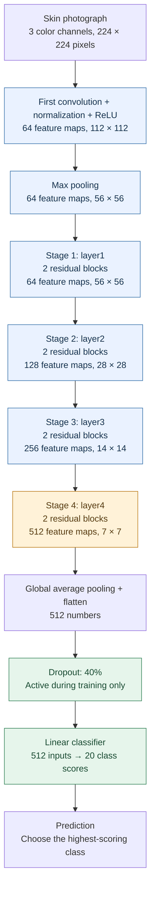
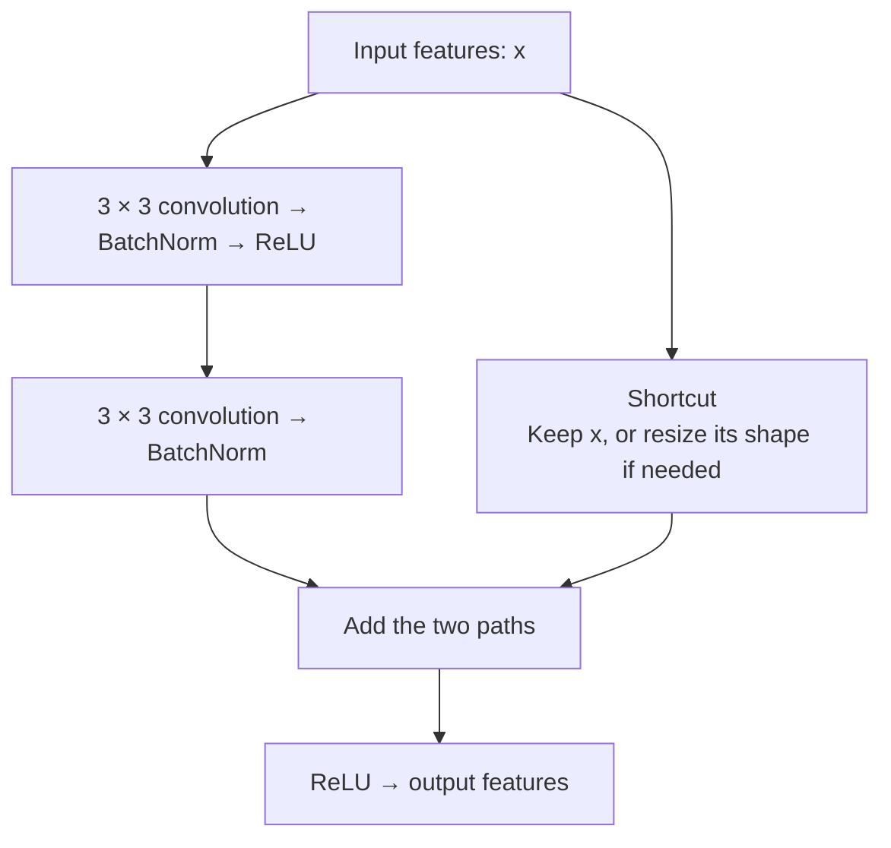
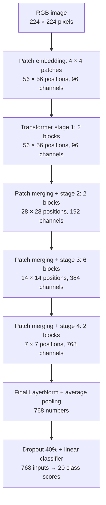

# DermaXRAI: understanding the neural network

A beginner-friendly guide to the model in [mainmodel.ipynb](mainmodel.ipynb).

## 1. What does the model do?

The model takes **one skin photograph** and chooses **one of 20 supported disease classes**. This is called *image classification*.

Choose **ResNet18** or **Swin-Tiny** with `model_name` in the notebook. ResNet18 is a convolutional neural network, or CNN. A CNN learns visual patterns by passing an image through a series of small filters. Swin-Tiny is a vision transformer that processes image patches using attention. Both produce one score for each class. Sections 2–7 explain the ResNet18 path; section 8 explains the Swin alternative.

The model receives image pixels. Captions, symptoms, patient history, and disease names are not inputs to the network. It does not draw a boundary around a lesion or locate it with a box.

## 2. The ResNet18 architecture at a glance

Read this diagram from top to bottom. Blue sections keep their pretrained weights. The final feature stage and classifier are adapted during training.



If your Markdown viewer cannot display Mermaid diagrams, the same architecture is:

```text
RGB image (224 × 224)
          │
          ▼
First convolution → Max pooling
          │
          ▼
Stage 1 → Stage 2 → Stage 3 → Stage 4
          │
          ▼
Average each of the 512 final feature maps
          │
          ▼
512 numbers → Dropout → Linear layer → 20 scores
                                           │
                                           ▼
                              Highest score = prediction
```

The drawing groups many operations into stages to make the network easier to follow. Each residual block contains two main convolutions, as explained below.

## 3. What happens inside each part?

### The input

Before reaching the network, the photograph is fitted into a **224 × 224** square with padding. It has three color channels: red, green, and blue. The channels are normalized using the ImageNet mean and standard deviation expected by the pretrained model.

PyTorch stores a batch of these images as `[N, 3, 224, 224]`, where `N` is the number of images. With the current batch size, a full batch contains 32 images. Each image still receives its own prediction.

### Convolution: looking for patterns

A convolution moves a small learned filter across the image. Think of it as a small window checking for a visual pattern at many positions.

Each filter produces a **feature map**: a grid showing where a particular learned pattern responds. Early layers can respond to simple edges and color transitions; deeper layers combine earlier signals into more complex features. These descriptions are intuition, not a guarantee that a particular filter represents a named medical feature.

The first convolution uses a **7 × 7 filter window** and stride 2. Stride 2 means the window advances two pixels at a time, reducing the spatial size. It produces 64 feature maps.

### Batch normalization and ReLU

**Batch normalization** adjusts intermediate values using learned scale and offset parameters and stored statistics. In this notebook, every BatchNorm layer is put in evaluation mode during training, so its stored running statistics stay fixed. The BatchNorm scale and offset inside `layer4` can still learn once that stage is unfrozen.

**ReLU** changes negative values to zero and leaves positive values unchanged. It allows the network to learn more complex relationships than repeated linear operations alone.

### Pooling: making a smaller summary

The first **max-pooling** operation keeps the largest value in each small window. It reduces the size of the feature maps while preserving strong responses.

At the end, **global average pooling** takes the average of each complete feature map. The 512 maps become 512 summary numbers. Flattening then arranges those numbers into one vector per image.

### The four feature stages

Each stage contains two residual blocks. As the network goes deeper, the maps become smaller and the number of channels grows.

| Part | Output for one image, written as channels × height × width | Role |
|---|---|---|
| Input | `3 × 224 × 224` | Color pixels |
| First convolution, BatchNorm, ReLU | `64 × 112 × 112` | Initial visual features |
| Max pooling | `64 × 56 × 56` | Smaller feature maps |
| `layer1` | `64 × 56 × 56` | First residual stage |
| `layer2` | `128 × 28 × 28` | More channels, smaller maps |
| `layer3` | `256 × 14 × 14` | Further feature combinations |
| `layer4` | `512 × 7 × 7` | Final feature stage |
| Average pooling and flatten | `512` | One compact image representation |
| Dropout | `512` | Regularization during training |
| Linear classifier | `20` | One score per disease class |

These shapes follow the ResNet18 implementation used by the notebook. They can also be checked in the [Torchvision ResNet source](https://docs.pytorch.org/vision/main/_modules/torchvision/models/resnet.html).

## 4. What makes ResNet a residual network?

A residual block has two paths: a path that learns a transformation and a shortcut that carries the input forward. The paths are added together.



In plain language:

```text
                    learned changes
                   /               \
input features ────                   + ──── ReLU ──── output
                   \               /
                    shortcut input
```

The idea is **“keep the existing information and learn useful changes to it.”** Shortcuts also give gradients a more direct route through the network during learning. This is the central idea of the [original ResNet paper](https://arxiv.org/abs/1512.03385).

When a new stage changes the number or size of channels, the shortcut uses a **1 × 1 convolution and BatchNorm** to make the two paths compatible before addition.

The “18” follows the usual count of one initial convolution, 16 main convolutions across eight residual blocks, and one final linear layer. Normalization, activation, pooling, and the shortcut projections are not included in that naming convention.

## 5. What was changed for DermaXRAI?

The notebook loads:

```python
model = resnet18(weights=ResNet18_Weights.DEFAULT)
model.fc = nn.Sequential(
    nn.Dropout(0.40),
    nn.Linear(model.fc.in_features, 20)
)
```

The pretrained network originally has a classifier for 1,000 ImageNet categories. The notebook replaces it with a new classifier for the 20 selected disease classes.

**Transfer learning** means starting with previously learned weights rather than learning every visual filter from the beginning. The backbone starts pretrained; the replacement classifier starts newly initialized.

The two parts of the replacement classifier are:

- **Dropout, probability 0.40:** randomly sets approximately 40% of the incoming feature values to zero during training and rescales the remaining values. It encourages the classifier to avoid relying on just a few features. All features are available during evaluation and prediction. Change `dropout_rate` to configure it.
- **Linear layer, 512 → 20:** learns how to combine the 512 features into the 20 class scores. It has 10,260 trainable parameters: `512 × 20` weights plus 20 biases.

The output positions map to `class_names`, which the notebook sorts alphabetically. This class order is saved with the model and must be preserved when loading it.

## 6. How does the model learn?

The notebook trains in two phases:

| Phase | What can learn? | Starting learning rate |
|---|---|---|
| Epochs 1–2 | New linear classifier | `0.001` |
| From epoch 3 | `layer4` | `0.0001` |
| From epoch 3 | New linear classifier | `0.0003` |

The initial convolution and `layer1`, `layer2`, and `layer3` remain **frozen**: their parameters are used to calculate features, but their values are not updated.

Here, `warmup_epochs = 2` means two epochs of classifier-only training. It does **not** mean that the learning rate gradually ramps up. At the start of epoch 3, the notebook creates a fresh AdamW optimizer for `layer4` and the classifier; the earlier optimizer's momentum estimates are not carried over.

### Continuing a saved run

Set `resume_training = True` and keep the original `run_name` to continue from that run's **best saved checkpoint**. This can be earlier than its last completed epoch. Keep the same architecture, sampling mode, model settings, and data split, then restart the kernel and run the notebook from the beginning. `number_of_epochs` is the total target, not the number of additional epochs. Older checkpoints without architecture or sampling metadata are treated as ResNet18 with balanced sampling disabled.

Before continuing, the notebook backs up the existing checkpoint and history. The active history keeps the entries up to the saved epoch and then records the new continuation. The best checkpoint is replaced only when validation macro F1 improves.

Older checkpoints restore the model weights and recover learning rates from the saved history, but start fresh AdamW estimates, scheduler state, and early-stopping counters. Newly saved checkpoints also contain these training states and the phase settings needed to restore them. Random generators are reseeded on restart, so resumed training is not guaranteed to reproduce an uninterrupted run exactly.

For a fresh experiment, leave `resume_training = False` and choose an unused run name.

For each batch, learning follows this sequence:

1. **Forward pass:** send images through the model to get 20 scores per image.
2. **Calculate loss:** compare those scores with the correct class labels.
3. **Backpropagation:** calculate how each trainable parameter contributed to the loss.
4. **Clip gradients:** limit their combined norm to 1.0 to control unusually large updates.
5. **Optimizer step:** let AdamW update the trainable parameters.

One **epoch** is one pass through that epoch's training images. A **learning rate** controls the size of the optimizer's updates; it is not an accuracy target.

### The loss: measuring the training error

Cross-entropy penalizes assigning a low score to the correct class relative to the other classes. Training passes the raw scores directly to cross-entropy; a separate softmax layer is not needed before this loss.

By default, `balanced_sampling = True`. Each image is given a sampling weight of `1 / number of images in its class`. The notebook draws with replacement, so all classes have equal expected exposure, while actual counts fluctuate. All training images remain available; an individual epoch can repeat some images and omit others. The loss is **unweighted cross-entropy**, so balancing is not also applied through loss weights. Validation images are neither oversampled nor reweighted.

With `balanced_sampling = False`, the notebook restores the earlier approach: shuffled training images and **weighted cross-entropy loss**. In that mode, the following calculation supplies the loss weights.

Less frequent classes receive larger weights. For each class, the notebook calculates:

```text
initial weight = square root(total images / (20 × images in that class))
final weight   = initial weight / average of all initial weights
```

This changes how strongly each class contributes to the training loss. It does not add images or force the model to predict all classes equally often. Validation loss is calculated without these class weights.

### AdamW and weight decay

**AdamW** uses running estimates of gradients and their squared values to adjust parameter updates. **Weight decay**, set to `0.001`, also shrinks the parameters included in the optimizer. Together with dropout, it provides regularization intended to reduce overfitting.

Both supported architectures use AdamW. SGD and a separate language model such as BERT are not used in these image-classification experiments.

### Learning-rate scheduling and stopping

From epoch 3, `ReduceLROnPlateau` monitors validation **macro F1**, where higher is better. Macro F1 averages the individual class F1 scores equally.

- `factor = 0.1`: a reduction makes each learning rate one tenth of its previous value.
- `learning_rate_patience = 1`: after a reference best score has been established, two consecutive validation checks without sufficient improvement trigger a reduction.
- `minimum_improvement = 0.0001`: defines a sufficient absolute improvement for the scheduler and early-stopping logic.
- `early_stopping_patience = 3`: training ends after three consecutive fine-tuning epochs without sufficient improvement.
- `number_of_epochs = 20`: the maximum length of a run.

The notebook initializes the scheduler using the best warmup macro F1 before evaluating the first fine-tuning epoch. It also saves a checkpoint whenever macro F1 exceeds the previous best, even when that increase is smaller than `minimum_improvement`. Therefore, the best saved checkpoint and the early-stopping counter use slightly different improvement rules.

The scheduler behavior is documented in [PyTorch's ReduceLROnPlateau reference](https://docs.pytorch.org/docs/stable/generated/torch.optim.lr_scheduler.ReduceLROnPlateau.html).

## 7. How does a trained model make a prediction?

Prediction uses the same image sizing and normalization, without the random training augmentation. The notebook reloads the best saved weights and switches the model to evaluation mode.

```text
Photograph
    ↓
224 × 224 normalized RGB image
    ↓
ResNet18 feature extractor
    ↓
512 image features
    ↓
Linear classifier; dropout is inactive
    ↓
20 raw scores, also called logits
    ↓
Softmax, when probabilities are requested
    ↓
Highest-scoring class, or the top five classes
```

**Softmax** converts the 20 raw scores into nonnegative values that sum to 1. Choosing the largest raw score or the largest softmax value gives the same predicted class. The validation function chooses directly from raw scores; the image-prediction cells calculate softmax values for display.

The model must choose among its 20 known classes. There is no “unknown disease” output or built-in rejection threshold. A high softmax value is a relative preference among these classes, not a medically verified probability or proof that the photograph belongs to a supported class.

## 8. The Swin-Tiny alternative

Set `model_name = "swin_t"` and leave `balanced_sampling = True` to prepare the second experiment. The default name becomes `swin_t_balanced_run_1`, keeping its model and reports separate from `resnet18_balanced_run_1`. Restart the kernel and run from the beginning when switching models.

Swin-Tiny begins with ImageNet-pretrained weights. It divides the image into patches and learns relationships between patches through **attention** within small windows. Alternating blocks shift these windows so information can move across window boundaries. Patch merging makes the spatial representation smaller while increasing the number of channels.



In text: **image → patches → four transformer stages → pooled features → classifier**.

The classifier trains alone for the first two epochs. From epoch 3, the final transformer stage and final LayerNorm also learn. Earlier stages remain frozen and in evaluation mode, which disables stochastic depth in those frozen stages. The classifier uses the same dropout setting as ResNet18. LayerNorm normalizes features without BatchNorm's running statistics.

The initial classifier learning rate is `0.001`; fine-tuning starts at `0.0001` for the final stage and LayerNorm and `0.0003` for the classifier. These are exposed as `warmup_learning_rate`, `backbone_learning_rate`, and `head_learning_rate` for both architectures. They are starting experiment settings, not established optimal values for Swin.

Both models use the same padding, input size, augmentation, normalization, and saved validation split for this comparison. This shared image preparation is an experiment choice; it differs from Swin's published resize-and-center-crop inference preset. The official architecture and pretrained preset are documented in [Torchvision's Swin-Tiny reference](https://docs.pytorch.org/vision/main/models/generated/torchvision.models.swin_t.html).

`split_reference_run` selects the previous run's saved training and validation manifests. The notebook verifies their filenames, labels, groups, and image hashes against the cleaned data before using them. Evaluation exports an additional `<run_name>_summary.csv` with the model choice, sampling mode, best epoch, and validation metrics.

## 9. A small glossary

| Term | Simple meaning |
|---|---|
| Parameter / weight | A number the network can learn |
| Feature | A numerical representation of a visual pattern |
| Backbone | The part that turns pixels into features |
| Classifier / head | The part that turns features into class scores |
| Frozen | Used in calculations, but its parameters are not updated |
| Fine-tuning | Adapting pretrained parameters to a new task |
| Batch | A small group of images processed together |
| Gradient | A signal describing how a parameter affects the loss |
| Overfitting | Learning training examples better than unseen examples |
| Checkpoint | Saved model weights and information needed to interpret them |
